# Reborn 🧬
### Interactive 3D Computational Drug Discovery & Molecular Workflow Platform
*Inspired by the MoleculeX Specification*

[](#git--three-branch-workflow-strategy)
[](#docker-deployment)
[](#interactive-3d-molecular-canvas)
[](#motion--interaction-design)
[](LICENSE)

---

## 🌟 Executive Overview

**Reborn** is an award-winning, full-stack computational drug discovery and biophysical workflow platform. It transforms complex *in silico* pharmaceutical workflows—from target receptor preparation and flexible ligand sampling to molecular docking, non-covalent contact fingerprinting, ADMET filtering, and 100ns molecular dynamics trajectory validation—into a vivid, smooth, and deeply interactive 3D web experience.

Designed to stand out in project showcases, competitions, and scientific reviews, Reborn bridges rigorous biophysical simulation paradigms with modern web technologies: React, Three.js (`@react-three/fiber`, `@react-three/drei`), GSAP, Node.js, Express, and MongoDB.

---

## 🎨 Visual & Motion Design Philosophy

Reborn adopts a bespoke, rich scientific dark-mode aesthetic engineered for high legibility, contrast, and visual prestige:

- **Deep Slate Navy (`#0B132B`, `#060B18`)**: Primary canvas and atmospheric depth.
- **Maroon (`#800000`) & Terracotta (`#A33B26`)**: Warm structural framing and transition accents.
- **Regal Gold (`#A4773A`, `#D4AF37`)**: Scientific metrics, lead candidate highlights, and golden-ratio UI ornaments.
- **Warm Off-White (`#F7F4EB`)**: High-contrast typographic clarity for scientific annotations.
- **Vibrant Status Highlights**:
  - **Cyan (`#00E5FF`)**: Hydrogen bonds, binding affinities, and docking grid cages.
  - **Emerald (`#10B981`)**: Passed criteria, stability convergence, and clean safety screens.
  - **Amber (`#F59E0B`)**: Hydrophobic contacts, intermediate warnings, and radar contours.
  - **Rose (`#F43F5E`)**: Salt bridges and rule-of-five violation alerts.

### Motion & Camera Choreography
- **GSAP (`gsap`)**: Drives fluid page entrances, stage-to-stage panel slide-ups, counter roll-ups, and magnetic button micro-interactions.
- **Three.js R3F (`@react-three/fiber`, `@react-three/drei`)**: Delivers real-time camera transitions between workflow stages:
  - **Stage 1**: Macro orbital cinematic view.
  - **Stage 2**: Target receptor zoom and secondary structure ribbon focus.
  - **Stage 3**: Ligand conformer centering.
  - **Stage 4**: Docking search grid box and multi-mode pose overlay.
  - **Stage 5**: Close-up inspection of hinge binding contacts (Met793, Lys745) with 3D billboard residue labels.
  - **Stage 6**: Multi-candidate comparative radar overlay.
  - **Stage 7**: 100ns molecular dynamics oscillation view.
  - **Stage 8**: Holographic discovery showcase.

---

## 🔬 The 8-Stage Computational Discovery Pipeline

```mermaid
flowchart LR
    S1["01. Project Setup\n(Indication & Forcefield)"] --> S2["02. Protein Input\n(PDB 1M17 & Prep)"]
    S2 --> S3["03. Ligand Library\n(SMILES & Conformers)"]
    S3 --> S4["04. Molecular Docking\n(AutoDock Vina Modes)"]
    S4 --> S5["05. Interactions\n(H-Bonds & Salt Bridges)"]
    S5 --> S6["06. ADMET & Ranking\n(Lipinski & Multi-Criteria)"]
    S6 --> S7["07. MD Validation\n(100ns RMSD / RMSF / Rg)"]
    S7 --> S8["08. Dossier Report\n(Provenance & Exports)"]

    classDef stage fill:#0E1834,stroke:#00E5FF,stroke-width:1.5px,color:#F7F4EB;
    class S1,S2,S3,S4,S5,S6,S7,S8 stage;
```



### Stage 1: Project Setup & Parameterization
- Define the therapeutic campaign target and disease indication (e.g., Non-Small Cell Lung Cancer, COVID-19 Mpro, KRAS G12C Solid Tumors).
- Select docking scoring functions (AutoDock Vina v1.2.5 empirical $\Delta G$) and molecular mechanics force fields (Amber ff14SB & GAFF2).
- Establish fixed random seeds (`4242`) for 100% deterministic reproducibility.

### Stage 2: Macromolecular Receptor Ingestion & Preparation
- Public PDB retrieval and mmCIF structure parsing (pre-seeded with **1M17** EGFR Kinase Domain, **6LU7** SARS-CoV-2 Mpro, and **4GIH** KRAS G12C).
- Automated preparation pipeline: rebuilds missing sidechain coordinates, assigns physiological protonation states (pH 7.4), assigns Kollman/Gasteiger partial charges, strips non-catalytic crystallographic water molecules, and executes gradient energy minimization.
- Interactive calibration of the catalytic pocket search grid (center $[x,y,z]$ and dimensions $[\Delta x, \Delta y, \Delta z]$).

### Stage 3: Small Molecule Ligand Ingestion & Conformer Generation
- Ingest compounds via canonical SMILES (Gefitinib, Erlotinib, Osimertinib analogue, or user-supplied custom SMILES).
- Computes real-time topological descriptors: Molecular Weight (MW), estimated octanol-water partition coefficient ($\text{cLog}P$), Hydrogen Bond Donors (HBD), Hydrogen Bond Acceptors (HBA), Topological Polar Surface Area (TPSA), and Rotatable Bonds.
- Samples low-energy 3D conformers with standard valence angles and non-bonded clash avoidance.

### Stage 4: Molecular Docking Execution
- Configures search grid box and exhaustiveness settings (8, 16, 32, 64).
- Simulates AutoDock Vina global Monte Carlo minimization over flexible ligand torsions.
- Generates 9 conformational modes ranked by empirical binding free energy ($\Delta G$ in $\text{kcal/mol}$), ligand efficiency, and root-mean-square deviations (RMSD lower/upper bounds).
- Real-time terminal log stream tracks grid affinity calculation, torsion sampling, and mode clustering.

### Stage 5: Non-Covalent Binding Interaction Fingerprinting
- Deconstructs atomic contacts stabilizing the docked complex:
  - **Directional Hydrogen Bonds**: Cyan dashed cylinders measuring distance (e.g., Met793 hinge nitrogen at 2.82 Å).
  - **Hydrophobic Dispersion Contacts**: Amber contact indicators across the lipophilic P-loop ceiling (Leu718).
  - **Coulombic Salt Bridges**: Electrostatic contacts anchoring catalytic lysine residues (Lys745).
  - **Aromatic $\pi$-Stacking**: Centroid-to-centroid $\pi$-$\pi$ sandwich interactions (Phe856).
- 3D Billboard callouts dynamically label pocket residues in real time.

### Stage 6: ADMET Profiling & Multi-Objective Ranking
- Evaluates candidate drug-likeness rules:
  - **Lipinski's Rule of 5**: $\text{MW} \le 500$, $\log P \le 5.0$, $\text{HBD} \le 5$, $\text{HBA} \le 10$.
  - **Veber Oral Bioavailability**: $\text{Rotatable Bonds} \le 10$, $\text{TPSA} \le 140\text{ \AA}^2$.
  - **PAINS Filter**: Scans for pan-assay interference motifs (e.g., quinones, azo compounds, rhodanine cores).
  - **ADMET Predictors**: Caco-2 intestinal permeability, Blood-Brain Barrier (BBB) permeability, CYP450 enzyme inhibition, and hERG cardiotoxicity risk.
- **Dynamic Multi-Criteria Weighting**: Interactive sliders allow users to adjust scoring priorities (lipophilicity, size, polarity, solubility, flexibility) to re-rank the candidate series dynamically.

### Stage 7: Advanced Validation (100ns Molecular Dynamics & Redocking)
- Evaluates 100ns explicit-solvent ($NPT$, $T = 300\text{ K}$, $P = 1.0\text{ bar}$, Amber ff14SB) simulation trajectories:
  - **Backbone & Ligand RMSD Convergence**: Shows structural equilibration at ~1.45 Å.
  - **Residue RMSF (Root-Mean-Square Fluctuation)**: Verifies rigidity of catalytic pocket residues (< 0.8 Å).
  - **MM-PBSA Continuum Solvation Free Energy**: Detailed decomposition into van der Waals ($-54.2\text{ kcal/mol}$), electrostatic ($-18.6\text{ kcal/mol}$), polar solvation ($+33.4\text{ kcal/mol}$), and net binding free energy ($-42.8\text{ kcal/mol}$).
  - **Redocking Benchmark Acceptance**: Re-docks crystallographic ligand and validates pose reproduction within **1.18 Å** RMSD (passing the < 2.0 Å gold-standard threshold).

### Stage 8: Curated Findings & Open Science Provenance Dossier
- Executive summary highlighting the designated lead candidate, predicted affinities, and ADMET composite score.
- Cryptographic provenance badge displaying SHA-256 input checksums, random seeds, and software version specifications.
- **One-Click Export Options**:
  - Full JSON audit package.
  - CSV candidate ranking leaderboard.
  - Formatted, print-ready discovery dossier.

---

## ⚠️ Scientific Regulatory Disclaimer

> **IMPORTANT SCIENTIFIC NOTICE:**
> All binding free energies ($\Delta G$), docking poses, ADMET predictions, and molecular dynamics trajectories computed within **Reborn** are computational simulations intended strictly for **research hypothesis prioritization, virtual screening, and candidate triage**.
> 
> *In silico* predictions cannot substitute for wet-lab biochemical validation. Any therapeutic lead must be validated experimentally using physical assays—such as Surface Plasmon Resonance (SPR), Isothermal Titration Calorimetry (ITC), enzymatic $IC_{50}$ assays, cytotoxicity screens, and animal pharmacokinetics (PK/PD)—prior to claiming biological efficacy or pharmacological safety.

---

## 🏗️ System Architecture

```
reborn/
├── backend/
│   ├── src/
│   │   ├── config/          # MongoDB connection & resilient in-memory fallback
│   │   ├── controllers/     # REST controllers for all 8 stages & reporting
│   │   ├── middleware/      # Error handling, rate limiting, helmet security
│   │   ├── models/          # Mongoose schemas (Project, Target, Ligand, Docking, etc.)
│   │   ├── routes/          # Express route definitions (/api/v1/...)
│   │   ├── services/        # Computational engine (SMILES, docking heuristics, ADMET)
│   │   ├── utils/           # Mock store & seed data generator (1M17, 6LU7, 4GIH)
│   │   └── server.js        # Express application entry point
│   ├── Dockerfile           # Multi-stage production Dockerfile
│   └── package.json
│
├── frontend/
│   ├── src/
│   │   ├── animations/      # GSAP timeline choreographies & stage transitions
│   │   ├── components/      # Navbar, Stepper, Stage controls (1-8), Modals, Drawers
│   │   │   └── stages/      # Stage1Setup to Stage8Reporting components
│   │   ├── hooks/           # Custom React hooks
│   │   ├── scenes/          # Three.js R3F 3D Molecular Stage (MolecularStage3D.jsx)
│   │   ├── services/        # Frontend API client (/api/v1/...)
│   │   ├── App.jsx          # Master layout & state orchestrator
│   │   ├── index.css        # Tailwind & custom scientific glassmorphism styles
│   │   └── main.jsx
│   ├── Dockerfile           # Multi-stage build + Nginx alpine reverse proxy
│   ├── index.html           # Fonts, metadata, and web manifest
│   ├── tailwind.config.js   # Custom Reborn color palette
│   ├── vite.config.js       # Vite configuration with /api reverse proxy
│   └── package.json
│
├── scripts/
│   └── push-update.sh       # Executable helper for atomic commits & pushing
│
├── docker-compose.yml       # Orchestrates frontend, backend, and mongo services
├── .env.example             # Documented environment variables
├── .gitignore
└── README.md
```

---

## 🚀 Quick Start & Setup Guide

### Option A: Running with Docker Compose (Recommended)

Ensure Docker and Docker Compose are installed, then run:

```bash
# 1. Clone repository
git clone https://github.com/ManamiMayoki/reborn.git
cd reborn

# 2. Launch multi-container environment
docker compose up --build
```

The application will be live at:
- **Frontend Web UI**: [http://localhost:3000](http://localhost:3000)
- **Backend API**: [http://localhost:5000/api/v1](http://localhost:5000/api/v1)
- **API Health Check**: [http://localhost:5000/api/v1/health](http://localhost:5000/api/v1/health)

---

### Option B: Local Development Setup (Node.js & npm)

#### Prerequisites
- Node.js v18+ (tested on Node v22)
- npm v9+
- MongoDB (Optional: Reborn features an intelligent **In-Memory Fallback Store** so the entire platform works out of the box with zero external database configuration!)

#### 1. Backend Setup
```bash
# Navigate to backend directory
cd backend

# Install dependencies
npm install

# Start development server with auto-reload and automated seeding
npm run dev
```
*The backend boots on port `5000` and automatically primes all benchmark targets, ligands, docking modes, and MD metrics.*

#### 2. Frontend Setup
```bash
# Open a new terminal and navigate to frontend directory
cd frontend

# Install dependencies
npm install

# Start Vite development server
npm run dev
```
*The frontend launches at [http://localhost:3000](http://localhost:3000) with automatic proxying of `/api` requests to `http://localhost:5000`.*

---

## 📡 REST API Reference (`/api/v1/...`)

| Method | Endpoint | Description |
| :--- | :--- | :--- |
| `GET` | `/api/v1/health` | System health check, database status, and platform metadata |
| `POST` | `/api/v1/seed` | Re-seeds benchmark computational discovery campaigns |
| `GET` | `/api/v1/projects` | List all discovery projects |
| `GET` | `/api/v1/projects/:id` | Get project details, active stage, and parameter settings |
| `POST` | `/api/v1/projects` | Create a new drug discovery campaign |
| `GET` | `/api/v1/targets?projectId=...` | Get target macromolecules and prepared 3D coordinates |
| `POST` | `/api/v1/targets/:id/prepare` | Calibrate protonation, charges, and active site grid box |
| `GET` | `/api/v1/ligands?projectId=...` | List small molecule candidates and descriptors |
| `POST` | `/api/v1/ligands` | Parse custom SMILES and generate 3D conformers |
| `GET` | `/api/v1/workflows/:projectId` | Get 8-stage workflow state, execution logs, and stage metrics |
| `POST` | `/api/v1/workflows/:projectId/advance` | Advance or switch active workflow stage (1 to 8) |
| `GET` | `/api/v1/docking?projectId=...` | Retrieve docking runs and ranked conformational poses |
| `POST` | `/api/v1/docking/run` | Execute simulated AutoDock Vina grid search job |
| `GET` | `/api/v1/interactions?dockingRunId=...` | Get classified binding contacts (H-bonds, salt bridges, $\pi$-stacking) |
| `GET` | `/api/v1/admet?projectId=...` | Get ADMET drug-likeness profiles and radar scores |
| `POST` | `/api/v1/admet/reweight` | Re-rank candidates based on user-defined multi-criteria weights |
| `GET` | `/api/v1/validation?projectId=...` | Get 100ns MD trajectory time series, RMSF, and redocking check |
| `GET` | `/api/v1/reports/summary?projectId=...` | Curated discovery summary and provenance hash |
| `GET` | `/api/v1/reports/export?format=csv` | Export candidate rankings as CSV or full JSON audit package |

---

## 🌿 Git & Three-Branch Workflow Strategy

Reborn adheres to an industrial three-branch release lifecycle to ensure atomic changes, staging verification, and stable deployments:

```
[development]  ---> Feature additions, UI/3D refinements, algorithm optimization
       │
       ▼ (Pull Request / Merge)
  [release]    ---> Staging environment, candidate verification, competition freeze
       │
       ▼ (Release Tag / Promotion)
 [production]  ---> Stable competition showcase & production deployment
```

### 1. Active Branch Strategy
- **`development`**: Active feature development, incremental updates, and experimental refinements.
- **`release`**: Release candidates, integration testing, and staging review.
- **`production`**: Tested, stable production release.

### 2. Automated Git Helper Script (`scripts/push-update.sh`)
To maintain small, atomic commits and automatic branch tracking, use the included helper script:

```bash
# Make executable (if not already set)
chmod +x scripts/push-update.sh

# Commit and push with a clear conventional message
./scripts/push-update.sh "feat(3d): enhance residue billboard labels and glowing contact cylinders"
```

The script automatically:
1. Detects the current active branch.
2. Stages all modified and new files (`git add -A`).
3. Creates a structured, atomic commit with your message.
4. Pushes cleanly to `origin/<current-branch>`.

---

## 🧪 Testing & Verification

```bash
# Test backend server startup & seeding
node backend/src/server.js

# Test frontend production bundle compilation
npm run build --prefix frontend
```

---

## 📜 License

Reborn is released under the **MIT License**. Created for scientific innovation, computational biophysics research, and project showcases.
